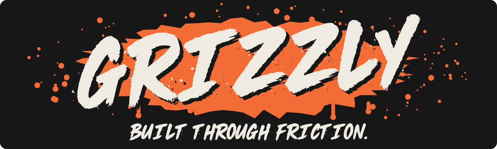

<p align="center">
  <a href="https://figadaffa.my.id">
    
  </a>
</p>

<p align="center">
  <b>Figa Daffa</b> · Informatics student at Universitas Muhammadiyah Malang<br>
  <i>Started with sketches. Rerouted to code. Still curious.</i>
</p>

<p align="center">
  <a href="https://figadaffa.my.id"></a>
  <a href="mailto:figabrilliantdafa1@gmail.com"></a>
  <a href="https://www.instagram.com/figadaffa/"></a>
</p>

---

### `// WHAT PULLS ME IN`

| | Interest | Why it matters to me |
|:-:|---|---|
| **01** | **Data** | In the age of AI, information matters. Good data helps test what's true. |
| **02** | **NLP** | Comparing traditional and Transformer-based models for hoax news detection. |
| **03** | **AI** | EVERTHING IS NOW AI |
| **04** | **Drawing & Graffiti** | Where my curiosity started, back in elementary school. |

### `// MY SPRAY CANS`

```text
DATA      Python · NLP
WEB       JavaScript · React · Vite · CSS
CREATIVE  Visual design · Canva
```

### `// GRIZZLY.PROFILE`

```js
const figa = {
  alias: "Grizzly",
  vibe: ["easygoing", "fun", "serious when it counts"],
  pastRole: "Head of Academics, HMIF UMM",
  openTo: ["internships", "freelance", "collaboration"],
};
```
### `// BY THE NUMBERS`

<p align="center">
  
</p>

<p align="center">
  
  
</p>

<p align="center">
  
</p>


### `// ON THE WALL`

**[Grizzly Portfolio](https://github.com/figadafa/grizzly)**: my street art portfolio, built with React and Vite. [See it live](https://figadaffa.my.id).

<p align="center"><sub>Got an idea? Let's paint it into something real.</sub></p>
